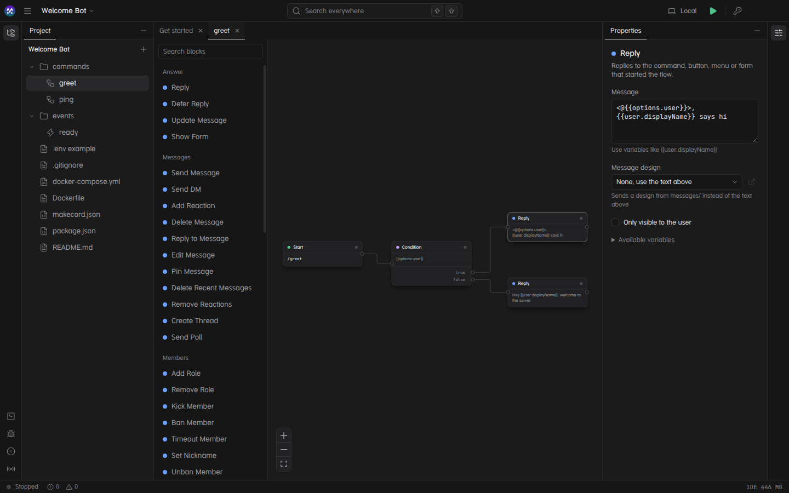
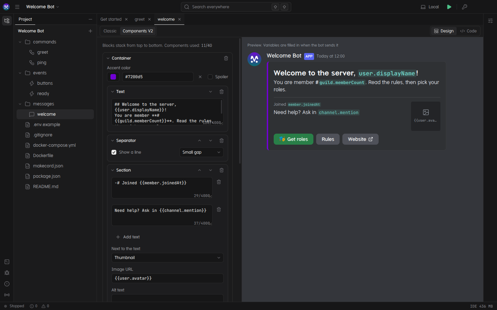

<p align="center">
  
</p>

<h1 align="center">Makecord</h1>

<p align="center">
  An open-source IDE for building Discord bots visually.<br>
  Design flows, test them live, and run the same bot on any server.
</p>

<p align="center">
  <a href="https://makecord.luzili.tech">Website</a>&emsp;
  <a href="https://makecord.luzili.tech/docs/">Documentation</a>&emsp;
  <a href="https://github.com/luzility/makecord/releases">Releases</a>
</p>

<p align="center">
  
</p>

## Why Makecord

Most bot builders are hosted services: your bot lives on someone else's servers, in a format you can't take with you. Makecord is a desktop app instead. A bot is a folder of plain JSON files that you own, version with Git and deploy anywhere Node runs.

- **Visual flows.** Commands and events are flows of blocks on a canvas. Connect blocks, fill in their settings, and use variables like `{{user.mention}}` anywhere.
- **Live while you build.** Press Run and the bot comes online. Saved changes reach it immediately, without a restart.
- **The same engine everywhere.** The IDE runs your bot with the exact runtime you deploy, so what works locally works on your VPS.
- **Local and private.** No account, no cloud. Your token is encrypted with the system keychain and never written to the project.
- **Extensible.** Plugins are npm packages that add blocks, with the same SDK the built-in blocks use.

## Features

**Flows**

- Slash commands with options, choices, autocomplete, subcommands and permission limits.
- User and message context menu commands.
- 27 events, from members joining and messages to reactions, voice, bans, threads, AutoMod, polls, buttons, menus, forms and schedules.
- 53 built-in blocks: replies, messages, DMs, roles, moderation, channels, threads, polls, forms, HTTP requests, loops, cooldowns, timestamps, persistent storage and more.

**Messages**

- A message designer for classic embeds and Discord's Components V2 layouts, with a Discord-style preview.
- Buttons and select menus, wired to flows by custom ID.

<p align="center">
  
</p>

**IDE**

- JetBrains-style workspace: project tree, properties, run log, problems, search everywhere and a full keymap.
- A debugger with breakpoints, stepping and a variable inspector, plus a live view of every gateway event the bot receives.
- Checks as you type: missing intents, unreachable blocks, blocks used where they can't work, buttons that nothing handles.
- Variable autocomplete (`{{`), Discord formatting helpers, copy and paste between flows, canvas notes.
- An invite link generator that ticks the permissions your blocks need.
- Monaco for code and JSON, with schema-aware completion.
- English and Turkish interface.

## How it works

A Makecord project is a regular folder:

```
my-bot/
├── makecord.json            name, intents, plugins, cache limits
├── commands/*.flow.json     slash and context menu commands
├── events/*.flow.json       gateway events, buttons, menus, forms, schedules
├── messages/*.message.json  message designs
├── package.json             "start": "makecord start ."
├── Dockerfile, docker-compose.yml, .env.example
└── data/                    persistent storage (git-ignored)
```

The IDE edits these files. The runtime, `@makecord/runtime`, reads them and runs the bot with [discord.js](https://discord.js.org). To host the bot, copy the folder to a server and run:

```bash
cp .env.example .env    # add DISCORD_TOKEN
npm install
npm start               # or: docker compose up -d
```

## Getting started

> [!NOTE]
> Makecord hasn't had its first release yet. Until then, run the IDE from source. The runtime isn't on npm yet either, so `npm install` inside a project only works once it's published.

You need Node 22.12 or newer and pnpm 12.

```bash
git clone https://github.com/luzility/makecord.git
cd makecord
pnpm install
pnpm dev:desktop
```

Then choose **New project**, add your bot token under **Secrets**, invite the bot with **Run › Invite bot to a server** and press **Run**. The [first bot guide](apps/web/src/content/docs/docs/first-bot.mdx) walks through it step by step.

## Documentation

The documentation lives in [`apps/web/src/content/docs`](apps/web/src/content/docs/docs) and is published with the website:

- [Flows](apps/web/src/content/docs/docs/flows.mdx), [variables](apps/web/src/content/docs/docs/variables.mdx) and [message designs](apps/web/src/content/docs/docs/messages.mdx)
- [Debugging](apps/web/src/content/docs/docs/debugging.mdx) and [problems](apps/web/src/content/docs/docs/problems.mdx)
- [Running a bot on a server](apps/web/src/content/docs/docs/self-hosting.mdx)
- [Writing plugins](apps/web/src/content/docs/docs/writing-plugins.mdx)

## Writing a plugin

A plugin adds blocks. Each block has metadata, which the IDE turns into a settings form, and a run function:

```ts
import { defineNode, defineNodeMeta, definePlugin } from "@makecord/plugin-sdk";
import { z } from "zod";

const roll = defineNodeMeta({
  type: "dice.roll",
  title: "Roll Dice",
  category: "data",
  fields: z.object({ sides: z.coerce.number().int().min(2).default(6) }),
});

export default definePlugin({
  id: "makecord-plugin-dice",
  version: "1.0.0",
  engines: { makecord: "^0.1.0" },
  nodes: [
    defineNode(roll, (ctx, { sides }) => {
      ctx.vars.set("roll", 1 + Math.floor(Math.random() * sides));
    }),
  ],
});
```

Publish it to npm with the `makecord-plugin` keyword and it shows up in the IDE's plugin marketplace. See the [plugin guide](apps/web/src/content/docs/docs/writing-plugins.mdx) for settings, ports, permissions and secrets.

## Development

This is a pnpm and Turborepo monorepo.

| Package                                      | What it is                                                |
| -------------------------------------------- | --------------------------------------------------------- |
| [`apps/desktop`](apps/desktop)               | The IDE: Electron, React, dockview, React Flow and Monaco |
| [`apps/web`](apps/web)                       | Website and documentation: Astro and Starlight            |
| [`packages/runtime`](packages/runtime)       | The headless bot engine and the `makecord` CLI            |
| [`packages/spec`](packages/spec)             | Zod schemas for project, flow and message files           |
| [`packages/plugin-sdk`](packages/plugin-sdk) | `definePlugin`, `defineNode` and the block context types  |
| [`plugins/core`](plugins/core)               | The built-in blocks                                       |
| [`packages/templates`](packages/templates)   | The new project template                                  |
| [`packages/config`](packages/config)         | Shared TypeScript configuration                           |

```bash
pnpm dev:desktop    # the IDE, with hot reload
pnpm dev:web        # the website at http://localhost:4321
pnpm build          # build everything
pnpm typecheck
pnpm test
pnpm lint           # Biome
```

To run a bot without the IDE:

```bash
pnpm --filter @makecord/runtime build
DISCORD_TOKEN=... node packages/runtime/dist/cli.js start ./path/to/bot --watch
```

Design decisions and how the pieces fit together are written up in [`docs/ARCHITECTURE.md`](docs/ARCHITECTURE.md) (in Turkish).

## Status

Makecord is young and is developed on Linux. Windows and macOS builds haven't been tested yet, and no bot built with it has run in production. Expect rough edges, and please report what you find.

## License

Makecord is licensed under the [Apache License 2.0](LICENSE). Bots you build with it are yours, under whatever license you choose.

The Makecord name and logo aren't covered by the license. Please don't use them for forks or other projects in a way that suggests they're the official Makecord.
